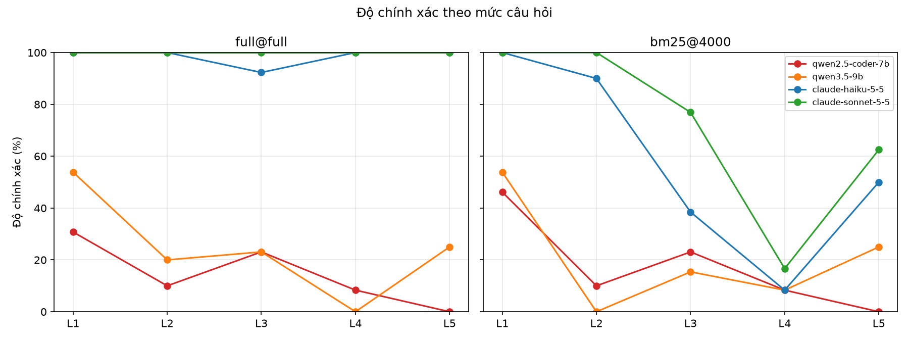

# REPORT — ccbench trên model cục bộ (qwen2.5-coder:7b, qwen3.5:9b)

**Trạng thái: HOÀN THÀNH (17/11/2026).** Mọi số liệu tính lại từ log thô bằng
`analysis/analyze.py` (scorer s2, chấm từ `raw_response`), đối chiếu chéo độc
lập khớp từng ô. Kế hoạch và ngưỡng kiểm định cố định trước khi chạy:
[RUNPLAN.md](RUNPLAN.md) (giữ nguyên làm prereg; nhãn verdict trong
`analysis/output/SUMMARY.md` dùng chữ của RUNPLAN, đọc diễn giải mới ở §2.1 và
§2.4). Bảng đầy đủ: [analysis/output/SUMMARY.md](analysis/output/SUMMARY.md).
Diễn giải trong báo cáo này đã đối chiếu bản khung mới của paper (17/11/2026).

## Tóm tắt

Trên cùng 64 câu frostline mà Claude đạt 98–100% khi đưa cả repository, hai
model nhỏ đạt 14,1% (7b) và 25,0% (9b). Phải đọc con số này kèm trần trên: ngay
cả khi chỉ đưa đúng mã cần thiết (oracle), 7b mới đạt 37,5% và 9b 42,2% — nên
phần lớn khoảng cách so với Claude là năng lực nền của model nhỏ, không chỉ do
nhiễu. Phần hụt thêm khi đưa cả repo (oracle − cả-repo) là +23,4 / +17,2 đ.p.t.
(CI loại 0): nhiễu gây thiệt hại thật ngay cả khi bằng chứng đã đủ (a=1). Chọn
lọc BM25 vẫn thắng cắt đầu ngữ cảnh ở mọi budget, nhưng mức thắng ở ô có ý
nghĩa chỉ +8…14 đ.p.t., nhỏ hơn nhiều so với +33…50 của Claude. Kết quả khớp
claim trung tâm của bản khung mới (17/11, mục V-B): với model nhỏ nút thắt là
*sử dụng* — nhiễu có cấu trúc giống mã cần thiết gây hại khi model chưa đủ mạnh
để bỏ qua nó, ngay cả khi bằng chứng đủ (a=1). Đây là dữ liệu model nhỏ đầu
tiên trên frostline (S3 của paper mới chỉ chạy Claude). Lưu ý: bản mới đã bác
bỏ giả thuyết "hướng hiệu ứng vị trí đổi theo quy mô" (nó gắn với họ model hơn
là số tham số, S4/S5); báo cáo này không kiểm định giả thuyết đó và không dùng
nhãn "giả thuyết quy mô" cho kết quả của mình.

## 1. Thiết lập

- Benchmark: ccbench (frostline v1, 64 câu L1–L5, ground truth bằng thực thi
  code; SHA `5e550060fea81413`, fixture `8da947b42b62564d`).
- Model: qwen2.5-coder:7b, qwen3.5:9b — Ollama **v0.40.16**, lượng tử hoá
  Q4_K_M, temperature 0, seed 0, output tối đa 1024 token, `num_ctx` 32.768,
  1 truy vấn/lần. qwen3.5 đặt `think:false` (không rò thinking).
- Phần cứng: 2× NVIDIA L4 24GB (driver 610.43.02, CUDA 13.3), chạy trên GPU 0;
  CentOS Stream 9, Python 3.11.17 (conda). Adapter `ollama_native` (/api/chat).
- 24 điều kiện × 64 câu = 1.536 lượt/model. Thời gian thực tế: 7b
  10:34–12:28 UTC (~1h54), 9b 12:28–15:19 UTC (~2h51), tổng ~4h45 (17/11/2026).
- Bản ghi: 7b 1.535 ok + 1 lỗi; 9b 1.536 ok + 0 lỗi (xem §4).
- Đối chiếu: Claude Haiku 5.5 / Sonnet 5.5 (S3 đã công bố, cùng tập câu;
  66/66 ô chấm lại khớp báo cáo gốc của kho).

## 2. Kết quả chính

### 2.1 Cả repository trong cửa sổ (a = 1) — HL1

| Model | Oracle (trần) | Acc cả-repo [CI 95%] | Claude cả-repo |
|---|---|---|---|
| qwen2.5-coder:7b | 37,5% | 14,1% [7,6–24,6] | 98,4% (Haiku) / 100% (Sonnet) |
| qwen3.5:9b | 42,2% | 25,0% [16,0–36,8] | 98,4% (Haiku) / 100% (Sonnet) |

Theo ngưỡng ghi trước trong RUNPLAN (acc ≤ 85% và cận trên CI < 95%), cả hai ô
đạt nhãn "u thấp khi a=1". Nhưng lưu ý trần oracle của model nhỏ vốn đã thấp
(37,5 / 42,2%), nên con số cả-repo phản ánh cả năng lực nền lẫn độ nhạy nhiễu;
không nên đọc là "sụp từ 100%". context_recall = 1,0 ở cả hai: bằng chứng đủ,
phần hụt thêm quy cho khâu sử dụng (định lượng ở HL3).

### 2.2 Chọn lọc so với cắt ở cùng budget — HL2

Hiệu số Acc(BM25) − Acc(full cắt), đ.p.t. (dương = chọn lọc thắng); b:c là số
câu chỉ BM25 đúng : chỉ full đúng, p là McNemar chính xác hai phía:

| Budget | 7b (b:c, p) | 9b (b:c, p) | Haiku | Sonnet |
|---|---|---|---|---|
| 2K | +14,1 (11:2, p=0,022) | +7,8 | — | — |
| 4K | +12,5 (10:2, p=0,039) | +7,8 (p=0,27) | +42,2 | +46,9 |
| 8K | +9,4 (p=0,070) | +14,1 (12:3, p=0,035) | +50,0 | +45,3 |
| 16K | +1,6 | +9,4 | — | — |

Chiều hướng tái lập (dương ở mọi ô) nhưng cường độ nhỏ hơn 3–5 lần so với
Claude. Ngưỡng ghi trước của RUNPLAN (≥10 đ.p.t. và p<0,05) chỉ xét ở 4K/8K:
mỗi model đạt đúng một ô (7b@4K, 9b@8K). Nếu xét thêm 2K thì 7b có thêm một ô
đạt ngưỡng. Kết luận: tái lập một phần — chọn lọc vẫn thắng cắt ở model nhỏ,
nhưng lợi ích co lại còn ~+8…14 đ.p.t. ở ô có ý nghĩa.

### 2.3 Giá của nhiễu và trần trên — HL3

oracle − cả-repo (bootstrap ghép cặp, hạt giống 7, 10.000 lần):

| Model | oracle − cả-repo [CI 95%] |
|---|---|
| qwen2.5-coder:7b | +23,4 đ.p.t. [10,9–35,9] |
| qwen3.5:9b | +17,2 đ.p.t. [6,2–28,1] |

Cả hai CI loại 0 → nhiễu trong cả-repo gây thiệt hại thật ngay cả khi a=1.
oracle_trace thấp hơn oracle một chút (7b 35,9 vs 37,5; 9b 40,6 vs 42,2), nhất
quán với V4: oracle viết tay không phải trần trên tuyệt đối.

### 2.4 Khác biệt giữa hai model — HL4

Trên cùng lưới 24 ô: **9b hơn 7b ở 23 ô, kém 1 ô, hoà 0**. Nhưng 7b
(Qwen2.5-Coder) và 9b (qwen3.5) thuộc **hai họ khác nhau**, nên theo bản khung
mới (họ model quyết định hồ sơ vị trí và độ nhạy nhiễu), không thể tách quy mô
khỏi họ ở thiết kế này. Con số 23/24 là khác biệt gộp họ + kích thước, không
phải bằng chứng "đơn điệu theo kích thước". Muốn tách quy mô cần thang cùng họ
(3B/7B/14B/32B) như S4 của paper.

### 2.5 Phân rã lỗi — HL5

Ở điều kiện cả-repo (a=1), tỉ lệ câu theo lớp lỗi:

| Model | use_failure | distractor_confusion | missing_evidence |
|---|---|---|---|
| qwen2.5-coder:7b | 79,7% | 6,2% | 0% |
| qwen3.5:9b | 70,3% | 4,7% | 0% |
| claude-haiku-5-5 | 1,6% | 0% | 0% |
| claude-sonnet-5-5 | 0% | 0% | 0% |

Phần sai ở model nhỏ hầu như thuần use_failure; distractor không đáng kể. Lưu ý
một phần nhãn này là định nghĩa: khi a=1, câu sai không khớp distractor bị xếp
use_failure, nên tỉ lệ use_failure cao đi kèm acc thấp là hệ quả tất yếu. Giá
trị thông tin là ở chỗ missing_evidence = 0 (xác nhận a=1) và distractor thấp
(model không bị đánh lừa bởi đáp án nhiễu), nhất quán với vế "a=1 mà u thấp ở
mô hình nhỏ" của paper.

### 2.6 Theo mức câu hỏi



Cả-repo: 7b L1=31%, L4=8%, L5=0%; 9b L1=54%, L4=0%, L5=25%; Claude ~100% mọi
mức. Model nhỏ thấp nhất ở câu đa bước (L4–L5), giữ được tương đối ở câu
trace đơn (L1). Cùng hình dạng ở BM25@4K.

## 3. Đối chiếu chéo các nghiên cứu của nhóm (cùng model)

| | S5 · D2 tổng hợp (5-KH) | S5 · toolz (5-KH) | ccbench (báo cáo này) |
|---|---|---|---|
| qwen2.5-coder:7b | có filler còn 0–28% tuỳ vị trí | xu hướng sụt, p=0,07 | cả-repo 14,1%; dưới budget 4,7–18,8% |
| qwen3.5:9b | chỉ sụt ở giữa tại 16k | không sụt (D=−0,04) | cả-repo 25,0%; hơn 7b 23/24 ô |

Bản khung mới xếp thang quy mô cùng họ (3B/7B/14B) vào S4 trên dữ liệu tổng
hợp, và kết luận hồ sơ vị trí gắn với họ model. ccbench của mình bổ sung mảnh
còn thiếu: **model nhỏ trên mã thật cả repository** (frostline), nơi S3 của
paper mới chỉ chạy Claude. Ở đó model nhỏ đạt thấp ngay cả khi a=1, khớp nút
thắt sử dụng của bản mới. Không nên đọc chênh lệch với toolz (9b không sụt)
thành mâu thuẫn: toolz/D2 đo hiệu ứng vị trí của một khối mã, ccbench đo suy
luận chuỗi gọi hàm trên cả repo — khác tác vụ, khác loại nhiễu (mã thật lạc đề
vs filler tổng hợp), khác hạ tầng (Q4 cục bộ vs API). Đây là bằng chứng hội tụ
ở mức mô tả, không phải phép đo đồng nhất.

## 4. Kiểm soát nhiễu và hạn chế

- Cắt output ở 1024 (`done_reason=length`): 7b = 1 lượt; 9b = 72 lượt. 9b chạm
  trần output nhiều hơn (dài dòng hơn dù think:false); một số đáp án đúng có
  thể bị cắt → acc 9b là cận dưới. Đây là hạn chế thật, ghi nhận rõ.
- Rò thinking: 0 ở cả hai model (smoke đã chặn; guard xác nhận lại trên toàn lưới).
- Cắt âm thầm prompt: 0. Guard kiểm tra context_recall ô cả-repo = 1,0. Token
  thật ô cả-repo: 7b ~19,7K, 9b ~20,7K (tokenizer qwen đếm khác Claude ~26,3K);
  không tràn cửa sổ 32K.
- 1 bản ghi lỗi: 7b, L1-02, dgc@16K — "token repeat limit reached" (model lặp
  vô hạn, Ollama tự dừng). Tính là sai theo giao thức; ô đó n=63. Không đổi kết
  luận. Hành vi này khớp mô tả S4-B của bản khung mới: 7B thiếu/nhiễu mã hay
  lặp vòng tới hết giới hạn đầu ra (12/40 mục), khác 14B biết từ chối.
- Một seed, một lần chạy, Q4_K_M, một GPU — CI theo câu, không theo lần chạy.
  Bản khung mới đã đưa cắt cụt đầu ra và tính không tất định vào nhóm kiểm
  soát (V7/V8) và yêu cầu lặp mỗi ô ≥2 lần ở hướng phát triển; đợt này chưa lặp.
- So sánh chéo model là mô tả (khác hạ tầng, khác họ), không phải kiểm định nhân quả.

## 5. Tái lập

```bash
# trên server GPU (chi tiết: SERVER_SETUP.md)
bash run_queue.sh
# tính lại mọi số liệu từ log thô
python3 analysis/analyze.py && python3 analysis/figures.py
```

Kết quả thô: `ccbench/results/local_*/results.jsonl` (phản hồi gốc + điểm +
provenance). Mọi bảng trong báo cáo này tính lại được từ các file đó.