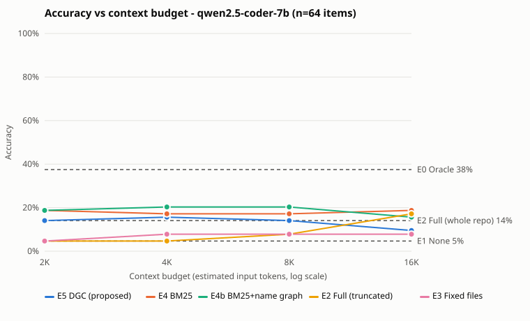
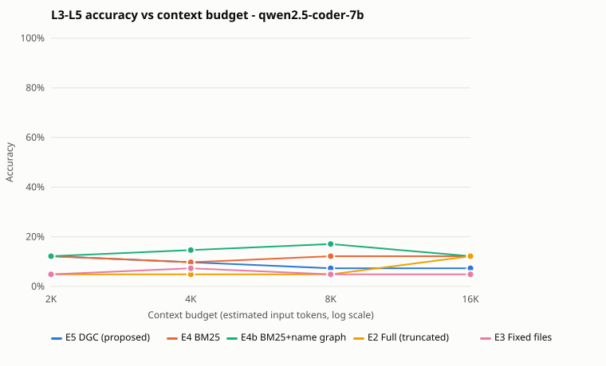
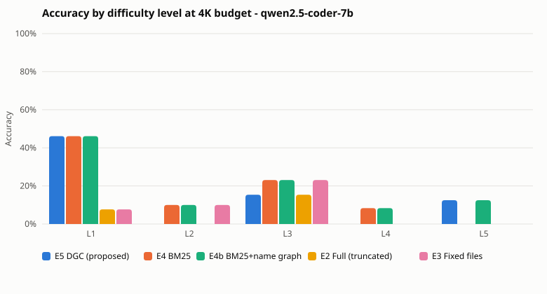
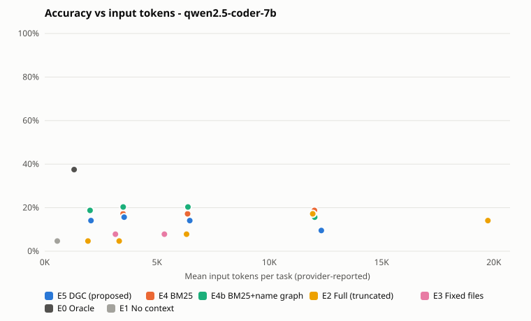

# Results - local_qwen7b-20261117-103433

- Created: 2026-11-17T10:34:33; dataset v1 (sha 5e550060fea81413); fixture 8da947b42b62564d; prompt p1; ccbench 1.0.0
- Providers (effective parameters): `{"qwen2.5-coder-7b": {"model": "qwen2.5-coder:7b", "temperature": 0.0, "seed": 0, "unsupported": [], "num_ctx": 32768, "think": null, "base_url": "http://localhost:11434"}}`
- Records: 1536 (ok 1535, errors 1); scored from raw responses with scorer s2

## Accuracy and cost per condition

| model | strategy | budget | n | acc % [95% CI] | L1 | L2 | L3 | L4 | L5 | ctx recall | evid. P | evid. R | est ctx tok | input tok | out tok | latency s | cost/task $ |
|---|---|---|---|---|---|---|---|---|---|---|---|---|---|---|---|---|---|
| qwen2.5-coder-7b | bm25 | 2000 | 64 | 18.8 [11.1, 30.0] | 46.2 | 10.0 | 23.1 | 0.0 | 12.5 | 44.4 | 50.9 | 28.8 | 1970 | 2019 | 126 | 3.0 |  |
| qwen2.5-coder-7b | bm25 | 4000 | 64 | 17.2 [9.9, 28.2] | 46.2 | 10.0 | 23.1 | 8.3 | 0.0 | 59.7 | 62.6 | 34.6 | 3949 | 3491 | 134 | 3.6 |  |
| qwen2.5-coder-7b | bm25 | 8000 | 64 | 17.2 [9.9, 28.2] | 46.2 | 0.0 | 30.8 | 8.3 | 0.0 | 75.0 | 59.9 | 37.2 | 7906 | 6364 | 146 | 4.9 |  |
| qwen2.5-coder-7b | bm25 | 16000 | 64 | 18.8 [11.1, 30.0] | 46.2 | 10.0 | 30.8 | 8.3 | 0.0 | 89.5 | 63.8 | 41.4 | 15802 | 12010 | 154 | 7.3 |  |
| qwen2.5-coder-7b | bm25_namegraph | 2000 | 64 | 18.8 [11.1, 30.0] | 46.2 | 10.0 | 15.4 | 0.0 | 18.8 | 45.8 | 48.7 | 28.1 | 1968 | 2020 | 132 | 3.1 |  |
| qwen2.5-coder-7b | bm25_namegraph | 4000 | 64 | 20.3 [12.3, 31.7] | 46.2 | 10.0 | 23.1 | 8.3 | 12.5 | 60.9 | 54.2 | 32.3 | 3946 | 3493 | 150 | 3.8 |  |
| qwen2.5-coder-7b | bm25_namegraph | 8000 | 64 | 20.3 [12.3, 31.7] | 46.2 | 0.0 | 30.8 | 8.3 | 12.5 | 77.1 | 63.0 | 38.5 | 7903 | 6378 | 150 | 4.8 |  |
| qwen2.5-coder-7b | bm25_namegraph | 16000 | 64 | 15.6 [8.7, 26.4] | 38.5 | 0.0 | 30.8 | 8.3 | 0.0 | 91.0 | 67.3 | 42.4 | 15801 | 12021 | 157 | 7.1 |  |
| qwen2.5-coder-7b | dgc | 2000 | 64 | 14.1 [7.6, 24.6] | 30.8 | 0.0 | 23.1 | 0.0 | 12.5 | 63.9 | 60.5 | 41.7 | 1968 | 2058 | 142 | 3.4 |  |
| qwen2.5-coder-7b | dgc | 4000 | 64 | 15.6 [8.7, 26.4] | 46.2 | 0.0 | 15.4 | 0.0 | 12.5 | 74.8 | 72.5 | 42.9 | 3945 | 3538 | 139 | 3.7 |  |
| qwen2.5-coder-7b | dgc | 8000 | 64 | 14.1 [7.6, 24.6] | 46.2 | 0.0 | 15.4 | 0.0 | 6.2 | 86.1 | 70.3 | 43.7 | 7900 | 6460 | 147 | 4.9 |  |
| qwen2.5-coder-7b | dgc | 16000 | 63 | 9.5 [4.4, 19.3] | 25.0 | 0.0 | 15.4 | 0.0 | 6.2 | 96.1 | 62.4 | 40.4 | 15802 | 12317 | 161 | 7.5 |  |
| qwen2.5-coder-7b | fixed | 2000 | 64 | 4.7 [1.6, 12.9] | 7.7 | 0.0 | 15.4 | 0.0 | 0.0 | 4.8 | 18.2 | 12.4 | 1942 | 1950 | 118 | 2.9 |  |
| qwen2.5-coder-7b | fixed | 4000 | 64 | 7.8 [3.4, 17.0] | 7.7 | 10.0 | 23.1 | 0.0 | 0.0 | 18.6 | 30.6 | 18.8 | 3694 | 3150 | 135 | 3.2 |  |
| qwen2.5-coder-7b | fixed | 8000 | 64 | 7.8 [3.4, 17.0] | 23.1 | 0.0 | 15.4 | 0.0 | 0.0 | 33.7 | 31.4 | 21.0 | 6870 | 5329 | 139 | 3.7 |  |
| qwen2.5-coder-7b | fixed | 16000 | 64 | 7.8 [3.4, 17.0] | 23.1 | 0.0 | 15.4 | 0.0 | 0.0 | 33.7 | 31.4 | 20.8 | 6870 | 5329 | 140 | 2.9 |  |
| qwen2.5-coder-7b | full | 2000 | 64 | 4.7 [1.6, 12.9] | 7.7 | 0.0 | 15.4 | 0.0 | 0.0 | 6.3 | 26.6 | 12.8 | 1972 | 1927 | 114 | 2.5 |  |
| qwen2.5-coder-7b | full | 4000 | 64 | 4.7 [1.6, 12.9] | 7.7 | 0.0 | 15.4 | 0.0 | 0.0 | 13.0 | 31.6 | 18.3 | 3862 | 3316 | 129 | 3.1 |  |
| qwen2.5-coder-7b | full | 8000 | 64 | 7.8 [3.4, 17.0] | 23.1 | 0.0 | 7.7 | 0.0 | 6.2 | 32.5 | 36.6 | 19.2 | 7889 | 6316 | 145 | 4.1 |  |
| qwen2.5-coder-7b | full | 16000 | 64 | 17.2 [9.9, 28.2] | 38.5 | 10.0 | 15.4 | 8.3 | 12.5 | 57.5 | 43.7 | 23.6 | 15722 | 11934 | 157 | 5.7 |  |
| qwen2.5-coder-7b | full | unbounded | 64 | 14.1 [7.6, 24.6] | 30.8 | 10.0 | 23.1 | 8.3 | 0.0 | 100.0 | 68.0 | 37.8 | 26320 | 19735 | 161 | 11.3 |  |
| qwen2.5-coder-7b | none | unbounded | 64 | 4.7 [1.6, 12.9] | 7.7 | 10.0 | 7.7 | 0.0 | 0.0 | 0.0 | 5.2 | 5.1 | 0 | 559 | 87 | 2.0 |  |
| qwen2.5-coder-7b | oracle | unbounded | 64 | 37.5 [26.7, 49.7] | 38.5 | 20.0 | 69.2 | 0.0 | 50.0 | 100.0 | 97.3 | 60.6 | 982 | 1309 | 140 | 3.0 |  |
| qwen2.5-coder-7b | oracle_trace | unbounded | 64 | 35.9 [25.3, 48.2] | 38.5 | 20.0 | 53.8 | 8.3 | 50.0 | 100.0 | 84.5 | 54.8 | 4666 | 3929 | 148 | 4.2 |  |

## Pre-registered hypotheses

### qwen2.5-coder-7b

- **H1a_2000** - inconclusive: `{"comparison": "dgc - bm25 @2000, L3-L5", "n_items": 41, "acc_dgc": 0.122, "acc_bm25": 0.122, "diff": 0.0, "ci95": [-0.12195121951219512, 0.12195121951219512], "p_bootstrap": 1.0, "mcnemar": [3, 3, 1.0], "p_holm": 1.0}`
- **H1a_4000** - inconclusive: `{"comparison": "dgc - bm25 @4000, L3-L5", "n_items": 41, "acc_dgc": 0.0976, "acc_bm25": 0.0976, "diff": 0.0, "ci95": [-0.0975609756097561, 0.0975609756097561], "p_bootstrap": 1.0, "mcnemar": [2, 2, 1.0], "p_holm": 1.0}`
- **H1b** - supported_uncorrected_only (fails Holm): `{"comparison": "(dgc@2K - full@2K) - (dgc@16K - full@unbounded)", "n_items": 63, "gap_low": 0.0952, "gap_high": -0.0476, "diff": 0.1429, "ci95": [0.031746031746031744, 0.25396825396825395], "p_bootstrap": 0.0222, "p_holm": 0.0888}`
- **H2a** - not equivalent: `{"comparison": "acc(dgc | CR=1) - acc(bm25 | CR=1), pooled over budgets", "n_dgc_cr1": 140, "n_bm25_cr1": 101, "acc_dgc_cr1": 0.1857, "acc_bm25_cr1": 0.297, "acc_dgc_cr_lt1": 0.0696, "acc_bm25_cr_lt1": 0.1032, "diff": -0.1113, "ci90": [-0.20594059405940596, -0.01782178217821781], "margin": 0.05}`
- **H2b** - supported: `{"comparison": "oracle-context error rate, L4-L5", "n": 28, "error_rate": 0.7143, "ci95": [0.529403642629825, 0.8474618415167003], "threshold": 0.15}`
- **H3b** - inconclusive: `{"comparison": "distractor-confusion rate on look-alike items, bm25 vs dgc @2K+4K", "rate_bm25": 0.0345, "rate_dgc": 0.0862, "bm25_only": 0, "dgc_only": 3, "p_mcnemar": 0.25, "p_holm": 0.75}`

## Other diagnostics

```json
{
  "flip_rate": null,
  "token_calibration": {
    "qwen2.5-coder-7b": {
      "n": 1535,
      "intercept_tokens": -20.42030224127666,
      "slope_actual_per_estimated": 0.7296028299481017
    }
  },
  "model_rank_agreement": {},
  "n_records": 1536,
  "n_ok": 1535,
  "n_errors": 1
}
```

## Charts





