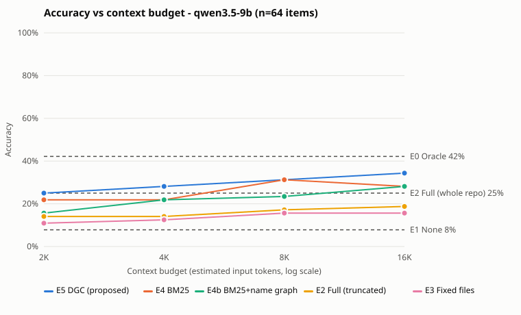
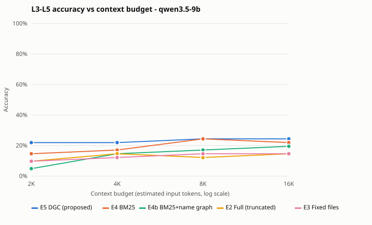
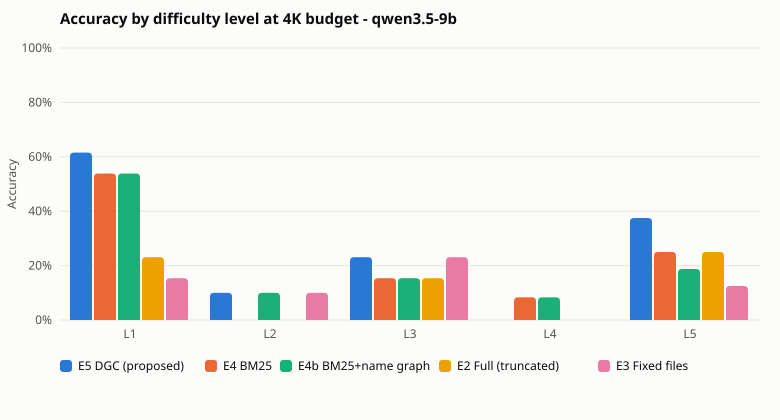
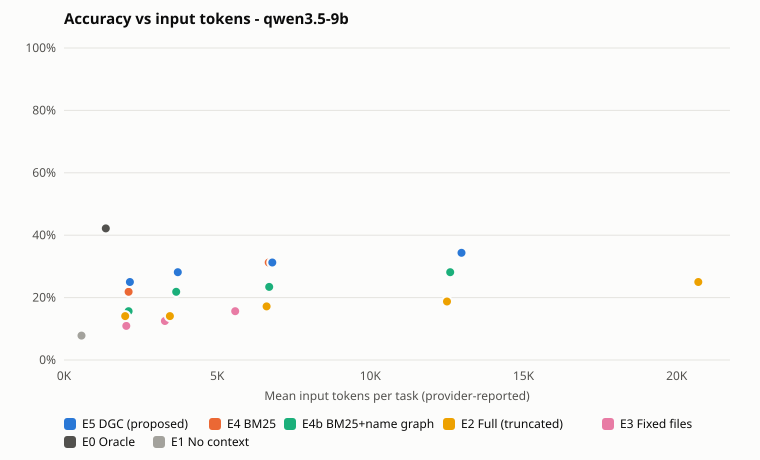

# Results - local_qwen9b-20261117-122842

- Created: 2026-11-17T12:28:42; dataset v1 (sha 5e550060fea81413); fixture 8da947b42b62564d; prompt p1; ccbench 1.0.0
- Providers (effective parameters): `{"qwen3.5-9b": {"model": "qwen3.5:9b", "temperature": 0.0, "seed": 0, "unsupported": [], "num_ctx": 32768, "think": false, "base_url": "http://localhost:11434"}}`
- Records: 1536 (ok 1536, errors 0); scored from raw responses with scorer s2

## Accuracy and cost per condition

| model | strategy | budget | n | acc % [95% CI] | L1 | L2 | L3 | L4 | L5 | ctx recall | evid. P | evid. R | est ctx tok | input tok | out tok | latency s | cost/task $ |
|---|---|---|---|---|---|---|---|---|---|---|---|---|---|---|---|---|---|
| qwen3.5-9b | bm25 | 2000 | 64 | 21.9 [13.5, 33.4] | 53.8 | 10.0 | 15.4 | 0.0 | 25.0 | 44.4 | 58.1 | 32.6 | 1970 | 2108 | 146 | 4.3 |  |
| qwen3.5-9b | bm25 | 4000 | 64 | 21.9 [13.5, 33.4] | 53.8 | 0.0 | 15.4 | 8.3 | 25.0 | 59.7 | 66.8 | 35.9 | 3949 | 3659 | 175 | 5.5 |  |
| qwen3.5-9b | bm25 | 8000 | 64 | 31.2 [21.2, 43.4] | 61.5 | 20.0 | 30.8 | 8.3 | 31.2 | 75.0 | 73.0 | 42.5 | 7906 | 6682 | 209 | 7.6 |  |
| qwen3.5-9b | bm25 | 16000 | 64 | 28.1 [18.6, 40.1] | 61.5 | 10.0 | 23.1 | 0.0 | 37.5 | 89.5 | 75.1 | 43.2 | 15802 | 12593 | 217 | 10.3 |  |
| qwen3.5-9b | bm25_namegraph | 2000 | 64 | 15.6 [8.7, 26.4] | 53.8 | 10.0 | 7.7 | 0.0 | 6.2 | 45.8 | 52.2 | 30.4 | 1968 | 2110 | 222 | 6.2 |  |
| qwen3.5-9b | bm25_namegraph | 4000 | 64 | 21.9 [13.5, 33.4] | 53.8 | 10.0 | 15.4 | 8.3 | 18.8 | 60.9 | 63.4 | 34.8 | 3946 | 3662 | 227 | 6.8 |  |
| qwen3.5-9b | bm25_namegraph | 8000 | 64 | 23.4 [14.7, 35.1] | 53.8 | 10.0 | 23.1 | 0.0 | 25.0 | 77.1 | 70.5 | 41.0 | 7903 | 6698 | 215 | 7.6 |  |
| qwen3.5-9b | bm25_namegraph | 16000 | 64 | 28.1 [18.6, 40.1] | 61.5 | 20.0 | 15.4 | 0.0 | 37.5 | 91.0 | 74.5 | 44.3 | 15801 | 12607 | 275 | 11.4 |  |
| qwen3.5-9b | dgc | 2000 | 64 | 25.0 [16.0, 36.8] | 53.8 | 0.0 | 23.1 | 0.0 | 37.5 | 63.9 | 69.3 | 42.1 | 1968 | 2153 | 188 | 5.4 |  |
| qwen3.5-9b | dgc | 4000 | 64 | 28.1 [18.6, 40.1] | 61.5 | 10.0 | 23.1 | 0.0 | 37.5 | 74.8 | 69.2 | 44.0 | 3945 | 3714 | 195 | 6.1 |  |
| qwen3.5-9b | dgc | 8000 | 64 | 31.2 [21.2, 43.4] | 61.5 | 20.0 | 30.8 | 0.0 | 37.5 | 86.1 | 71.7 | 44.8 | 7900 | 6800 | 254 | 8.8 |  |
| qwen3.5-9b | dgc | 16000 | 64 | 34.4 [23.9, 46.6] | 61.5 | 40.0 | 38.5 | 0.0 | 31.2 | 96.1 | 77.3 | 46.1 | 15802 | 12976 | 264 | 11.6 |  |
| qwen3.5-9b | fixed | 2000 | 64 | 10.9 [5.4, 20.9] | 15.4 | 10.0 | 23.1 | 0.0 | 6.2 | 4.8 | 21.9 | 8.4 | 1942 | 2035 | 165 | 4.8 |  |
| qwen3.5-9b | fixed | 4000 | 64 | 12.5 [6.5, 22.8] | 15.4 | 10.0 | 23.1 | 0.0 | 12.5 | 18.6 | 39.7 | 14.6 | 3694 | 3295 | 151 | 4.6 |  |
| qwen3.5-9b | fixed | 8000 | 64 | 15.6 [8.7, 26.4] | 30.8 | 0.0 | 23.1 | 0.0 | 18.8 | 33.7 | 38.8 | 17.1 | 6870 | 5588 | 196 | 6.1 |  |
| qwen3.5-9b | fixed | 16000 | 64 | 15.6 [8.7, 26.4] | 30.8 | 0.0 | 23.1 | 0.0 | 18.8 | 33.7 | 38.8 | 17.1 | 6870 | 5588 | 196 | 4.9 |  |
| qwen3.5-9b | full | 2000 | 64 | 14.1 [7.6, 24.6] | 38.5 | 0.0 | 15.4 | 0.0 | 12.5 | 6.3 | 34.9 | 10.7 | 1972 | 1997 | 105 | 3.4 |  |
| qwen3.5-9b | full | 4000 | 64 | 14.1 [7.6, 24.6] | 23.1 | 0.0 | 15.4 | 0.0 | 25.0 | 13.0 | 33.1 | 13.8 | 3862 | 3457 | 112 | 3.7 |  |
| qwen3.5-9b | full | 8000 | 64 | 17.2 [9.9, 28.2] | 30.8 | 20.0 | 15.4 | 0.0 | 18.8 | 32.5 | 44.1 | 20.8 | 7889 | 6615 | 144 | 5.2 |  |
| qwen3.5-9b | full | 16000 | 64 | 18.8 [11.1, 30.0] | 30.8 | 20.0 | 15.4 | 0.0 | 25.0 | 57.5 | 52.0 | 27.0 | 15722 | 12504 | 174 | 7.2 |  |
| qwen3.5-9b | full | unbounded | 64 | 25.0 [16.0, 36.8] | 53.8 | 20.0 | 23.1 | 0.0 | 25.0 | 100.0 | 76.6 | 46.4 | 26320 | 20706 | 195 | 13.3 |  |
| qwen3.5-9b | none | unbounded | 64 | 7.8 [3.4, 17.0] | 15.4 | 0.0 | 7.7 | 0.0 | 12.5 | 0.0 | 0.0 | 0.0 | 0 | 570 | 89 | 2.5 |  |
| qwen3.5-9b | oracle | unbounded | 64 | 42.2 [30.9, 54.4] | 53.8 | 20.0 | 69.2 | 0.0 | 56.2 | 100.0 | 98.4 | 55.5 | 982 | 1363 | 168 | 4.6 |  |
| qwen3.5-9b | oracle_trace | unbounded | 64 | 40.6 [29.5, 52.9] | 46.2 | 20.0 | 69.2 | 8.3 | 50.0 | 100.0 | 94.4 | 52.6 | 4666 | 4109 | 267 | 8.2 |  |

## Pre-registered hypotheses

### qwen3.5-9b

- **H1a_2000** - inconclusive: `{"comparison": "dgc - bm25 @2000, L3-L5", "n_items": 41, "acc_dgc": 0.2195, "acc_bm25": 0.1463, "diff": 0.0732, "ci95": [-0.07317073170731707, 0.21951219512195122], "p_bootstrap": 0.3985, "mcnemar": [6, 3, 0.5078125], "p_holm": 1.0}`
- **H1a_4000** - inconclusive: `{"comparison": "dgc - bm25 @4000, L3-L5", "n_items": 41, "acc_dgc": 0.2195, "acc_bm25": 0.1707, "diff": 0.0488, "ci95": [-0.07317073170731707, 0.17073170731707318], "p_bootstrap": 0.5362, "mcnemar": [4, 2, 0.6875], "p_holm": 1.0}`
- **H1b** - inconclusive: `{"comparison": "(dgc@2K - full@2K) - (dgc@16K - full@unbounded)", "n_items": 64, "gap_low": 0.1094, "gap_high": 0.0938, "diff": 0.0156, "ci95": [-0.125, 0.15625], "p_bootstrap": 0.9168, "p_holm": 1.0}`
- **H2a** - not equivalent: `{"comparison": "acc(dgc | CR=1) - acc(bm25 | CR=1), pooled over budgets", "n_dgc_cr1": 141, "n_bm25_cr1": 101, "acc_dgc_cr1": 0.4468, "acc_bm25_cr1": 0.4356, "acc_dgc_cr_lt1": 0.113, "acc_bm25_cr_lt1": 0.1419, "diff": 0.0112, "ci90": [-0.09360297731900852, 0.11459869391194433], "margin": 0.05}`
- **H2b** - supported: `{"comparison": "oracle-context error rate, L4-L5", "n": 28, "error_rate": 0.6786, "ci95": [0.4933850455563118, 0.8206695245657927], "threshold": 0.15}`
- **H3b** - inconclusive: `{"comparison": "distractor-confusion rate on look-alike items, bm25 vs dgc @2K+4K", "rate_bm25": 0.1034, "rate_dgc": 0.069, "bm25_only": 2, "dgc_only": 0, "p_mcnemar": 0.5, "p_holm": 1.0}`

## Other diagnostics

```json
{
  "flip_rate": null,
  "token_calibration": {
    "qwen3.5-9b": {
      "n": 1536,
      "intercept_tokens": -30.98332314322306,
      "slope_actual_per_estimated": 0.7662291110044759
    }
  },
  "model_rank_agreement": {},
  "n_records": 1536,
  "n_ok": 1536,
  "n_errors": 0
}
```

## Charts





