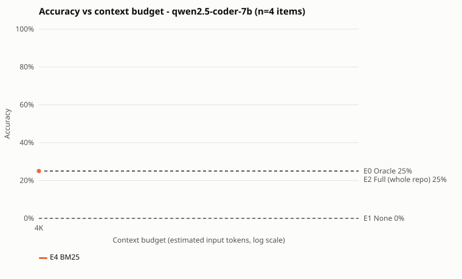
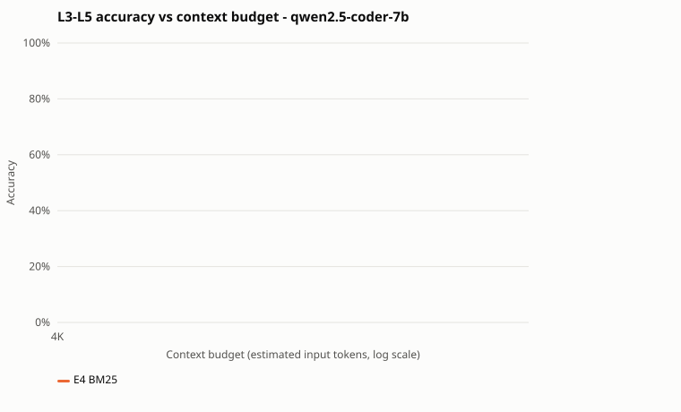
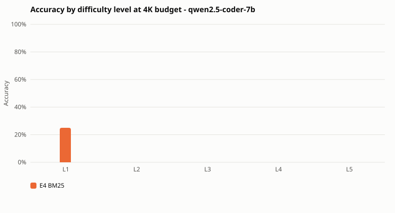
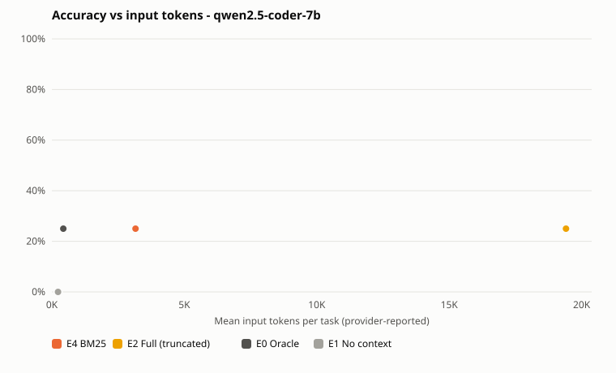
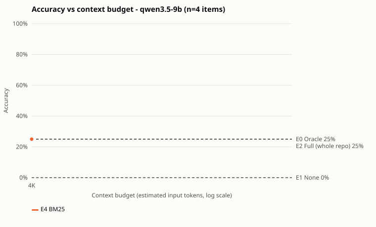
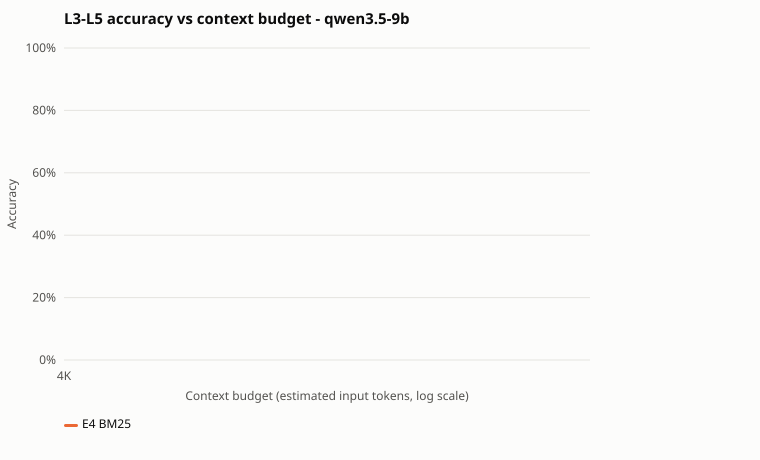
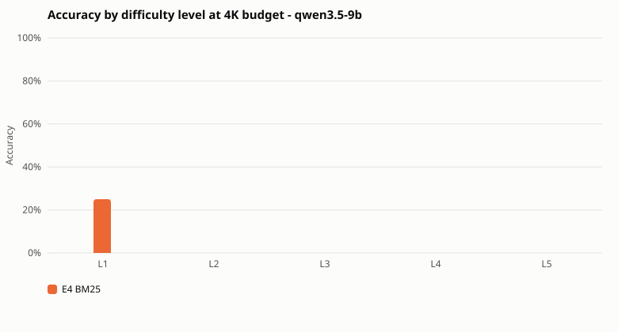
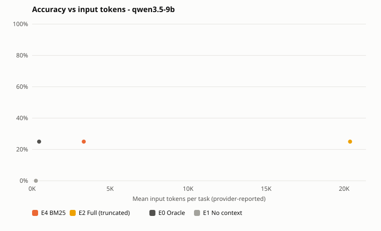

# Results - local_smoke-20261117-102105

- Created: 2026-11-17T10:21:05; dataset v1 (sha 5e550060fea81413); fixture 8da947b42b62564d; prompt p1; ccbench 1.0.0
- Providers (effective parameters): `{"qwen2.5-coder-7b": {"model": "qwen2.5-coder:7b", "temperature": 0.0, "seed": 0, "unsupported": [], "num_ctx": 32768, "think": null, "base_url": "http://localhost:11434"}, "qwen3.5-9b": {"model": "qwen3.5:9b", "temperature": 0.0, "seed": 0, "unsupported": [], "num_ctx": 32768, "think": false, "base_url": "http://localhost:11434"}}`
- Records: 32 (ok 32, errors 0); scored from raw responses with scorer s2

## Accuracy and cost per condition

| model | strategy | budget | n | acc % [95% CI] | L1 | L2 | L3 | L4 | L5 | ctx recall | evid. P | evid. R | est ctx tok | input tok | out tok | latency s | cost/task $ |
|---|---|---|---|---|---|---|---|---|---|---|---|---|---|---|---|---|---|
| qwen2.5-coder-7b | bm25 | 4000 | 4 | 25.0 [4.6, 69.9] | 25.0 |  |  |  |  | 100.0 | 91.7 | 58.3 | 3946 | 3159 | 124 | 3.7 |  |
| qwen2.5-coder-7b | full | unbounded | 4 | 25.0 [4.6, 69.9] | 25.0 |  |  |  |  | 100.0 | 93.8 | 83.3 | 26320 | 19410 | 190 | 14.6 |  |
| qwen2.5-coder-7b | none | unbounded | 4 | 0.0 [0.0, 49.0] | 0.0 |  |  |  |  | 0.0 | 0.0 | 0.0 | 0 | 234 | 80 | 4.6 |  |
| qwen2.5-coder-7b | oracle | unbounded | 4 | 25.0 [4.6, 69.9] | 25.0 |  |  |  |  | 100.0 | 100.0 | 70.8 | 233 | 431 | 139 | 2.8 |  |
| qwen3.5-9b | bm25 | 4000 | 4 | 25.0 [4.6, 69.9] | 25.0 |  |  |  |  | 100.0 | 100.0 | 83.3 | 3946 | 3313 | 192 | 6.0 |  |
| qwen3.5-9b | full | unbounded | 4 | 25.0 [4.6, 69.9] | 25.0 |  |  |  |  | 100.0 | 100.0 | 83.3 | 26320 | 20380 | 163 | 12.3 |  |
| qwen3.5-9b | none | unbounded | 4 | 0.0 [0.0, 49.0] | 0.0 |  |  |  |  | 0.0 | 0.0 | 0.0 | 0 | 244 | 112 | 17.3 |  |
| qwen3.5-9b | oracle | unbounded | 4 | 25.0 [4.6, 69.9] | 25.0 |  |  |  |  | 100.0 | 100.0 | 83.3 | 233 | 451 | 112 | 2.9 |  |

## Pre-registered hypotheses

### qwen2.5-coder-7b


### qwen3.5-9b


## Other diagnostics

```json
{
  "flip_rate": null,
  "token_calibration": {
    "qwen2.5-coder-7b": {
      "n": 16,
      "intercept_tokens": -30.75218830796439,
      "slope_actual_per_estimated": 0.7274067802895473
    },
    "qwen3.5-9b": {
      "n": 16,
      "intercept_tokens": -34.62767576965689,
      "slope_actual_per_estimated": 0.7638382877633826
    }
  },
  "model_rank_agreement": {
    "qwen2.5-coder-7b vs qwen3.5-9b": {
      "n_cells": 4,
      "kendall_tau": 1.0
    }
  },
  "n_records": 32,
  "n_ok": 32,
  "n_errors": 0
}
```

## Charts









